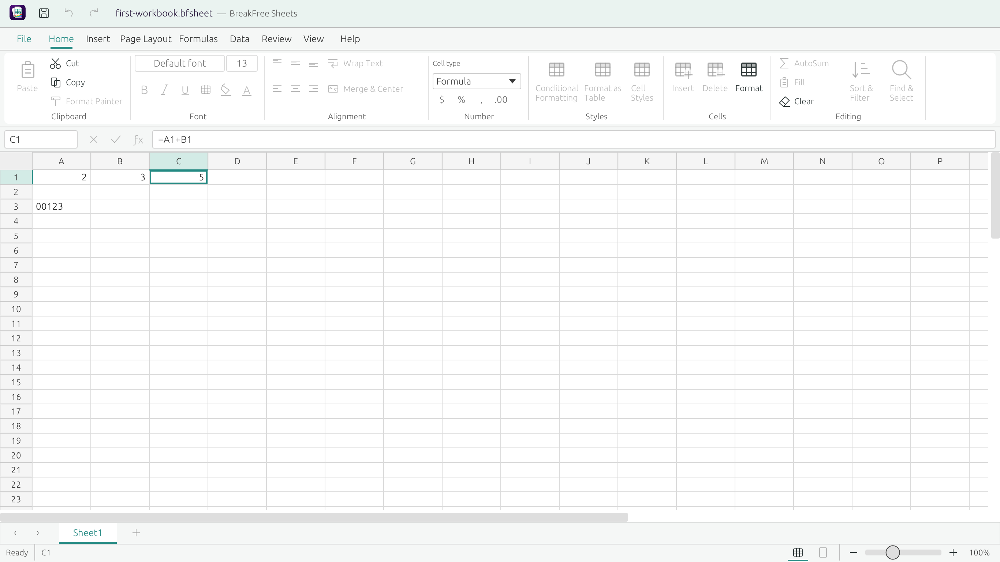

<p align="center">
  <a href="https://github.com/PerchAnton/breakfree-office"></a>
</p>

<h1 align="center">BreakFree Sheets</h1>

<p align="center"><strong>Your numbers. Your freedom.</strong><br>Independent native Rust spreadsheet prototype.</p>

> Working prototype for review. Rust is the owner's chosen language for every
> application layer. Desktop Excel 2024 for Windows is the layout/interaction
> target; the identity remains BreakFree Sheets. Visual identity, XLSX
> compatibility and a supported-platform release are not claimed.

Current development candidate: **`0.1.0-alpha.1`**, awaiting owner version approval.
No product release is published. See the [version and approval policy](docs/VERSIONING.md).

## Build and run independently

Install Rust using the official [Rust toolchain installer](https://rustup.rs/).
The repository pins Rust 1.99.1 and the resolved dependency graph in Cargo.lock.
A native platform linker/SDK is required (Windows: Visual Studio Build Tools with
Desktop development with C++; macOS: Xcode command-line tools). Linux native
GUI builds need X11/Wayland/OpenGL development libraries, including
`libxkbcommon-x11-dev` on Ubuntu for the X11 runtime loader; see CI for the full list.
There is no Office, Docs, Slides, Python, JavaScript frontend, WebView or account
requirement. Only Cargo's first dependency download needs the registry; there
are no build/runtime fetches of Office or mutable remote specifications.

```sh
cargo build --locked
cargo run --locked -- --new
cargo run --locked -- --open "/absolute/path/My workbook.bfsheet"
cargo run --locked -- --capabilities
cargo run --locked -- --version
cargo build --locked --release
```

Windows PowerShell, from this repository:

```powershell
cargo build --locked --release
.\target\release\breakfree-sheets.exe --new
.\target\release\breakfree-sheets.exe --open "C:\Users\You\Documents\My workbook.bfsheet"
.\target\release\breakfree-sheets.exe --capabilities
.\target\release\breakfree-sheets.exe --version
```

macOS/Linux executable: `target/release/breakfree-sheets`. After dependencies
have been fetched, `cargo build --locked --offline` works without a network.
Copying the native executable to another directory does not require this checkout;
its approved icon is embedded. Runtime system graphics libraries still apply.
No native installer, signed package or public binary release is produced here.

## Work with real cells

The light desktop layout has File and ribbon tabs, Home groups, a name box,
formula bar, headers, active/range selection, sheet area, scrollbars and zoom.
Home uses compact icon groups; File opens the working local document page with
New/Open/Save/Save As/Close and unsaved-change protection.



*Actual macOS application frame; Windows reference comparison remains pending.*

One sheet A1–Z100 is implemented. The grid paints only visible cells; it does
not allocate a heavy widget for every possible cell.

Click A1, type `2`, Enter. Set B1 to `3`. Select C1, click the formula bar, enter
`=A1+B1`, Enter: C1 displays **5**. Replace A1 with `4` through the grid: C1
becomes **7**. Undo returns it to 5; redo returns 7. Save as `.bfsheet`, open it
again, and edit A1: the stored formula still recalculates. The synthetic
[example workbook](examples/first-workbook.bfsheet) opens in the Rust application,
including files created by the earlier prototype.

Typing starts inline edit; F2 or double click edits existing source. The formula
bar and inline cell share one draft. Enter/Tab commit and move; Shift reverses;
Escape cancels. Arrows navigate in selection mode; Shift+arrows/drag select a
range. The address box accepts `A1` or `A1:C4`. Drag header boundaries or use Home
Cells → Format to resize. Worksheet zoom is independent of system display DPI.
View dimensions and zoom reset on New/Open; they are not persisted in native v1.

New blank-cell entry uses **Auto (safe)**: formulas start with `=`, canonical
decimal input becomes Number, leading-zero identifiers such as `00123` stay Text.
F2/formula-bar edits retain the stored kind unless the selector changes. Typing
a complete replacement in selection mode applies safe Auto inference again.
Choose Text/Number/Formula explicitly using Home Number → Cell type when desired. Types and
sources are stored separately from formatted results; decimal dots are explicit.

The engine supports `+ - * /`, parentheses, unary minus and single-cell references.
It uses 28-digit decimal floating point with half-even rounding after every
operation, calculated from exact rational intermediates. This is **not a financial
accuracy guarantee**. Syntax, division-by-zero, cycles, text operands, invalid
references and numeric/resource limits produce explicit errors. Macros, general
code evaluation, external links and network formulas are never executed.

Undo/redo retains 500 commands; Clear removes a selected range in one step.
Clipboard buttons handle one typed cell and preserve literal formula references;
range paste/reference translation are not implemented. Unsupported formatting,
functions, fill, sort/filter, row insertion/deletion, charts and extra sheets
are visibly disabled. Status has no fictitious Sum/Average/Count. New/Open/Close
protect unsaved data and pending edits with Save/Discard/Cancel.

## Validate

```sh
cargo test --locked --no-default-features
cargo test --locked
cargo fmt --all -- --check
cargo clippy --locked --all-targets --all-features -- -D warnings
```

The first command tests the pure model/engine/files/Office CLI without compiling
GUI dependencies. The default tests also feed real pointer/key/text events to
the native Rust UI components, including grid → formula → recalc → undo → save →
reopen. Those tests do not need a display and do not replace Windows DPI testing.
The Rust conformance fixtures preserve 35 scenarios from the original Python v1
engine; Python is not needed to run them. Historical source remains under
[legacy/python](legacy/python/README.md), outside the product/build.

See [validation evidence](docs/VALIDATION.md), [UI geometry, sources and real
captures](docs/UI_SPEC.md), [owner decisions](docs/adr/0003-rust-native-desktop.md),
[calculation/native-v1 semantics](docs/adr/0002-calculation-and-storage.md),
[temporary Office contract](contracts/v1/SNAPSHOT.md) and [roadmap](ROADMAP.md).
The available own-app screenshots are macOS captures. Actual Excel 2024 Windows
comparison and Windows 100/125/150% display checks remain explicitly unverified.

## Development and independence

| Area | State |
| :--- | :--- |
| Language | Rust, owner-decided for the entire application |
| GUI | Native Rust egui/eframe; provisional toolkit implementation, no web table |
| Calculation/persistence | Restricted tested engine, native v1 `.bfsheet`, atomic replacement |
| Office | Independent executable with v1 JSON/CLI; upstream contract reconciliation pending |
| Compatibility | No CSV/XLSX or Excel numeric/visual parity claim |
| License | Owner decision pending; no license selected |
| Release | Draft review work only; no automatic merge or release |

[BreakFree Office](https://github.com/PerchAnton/breakfree-office) is the suite hub.
[Docs](https://github.com/PerchAnton/breakfree-docs) and
[Slides](https://github.com/PerchAnton/breakfree-slides) remain separate applications.
Sheets builds/tests/runs without their repositories or installations.

Read [AGENTS.md](AGENTS.md), [CONTRIBUTING.md](CONTRIBUTING.md) and
[the project journal](docs/PROJECT_LOG.md). People of every background, including
LGBTQ+ contributors and users, are welcome; follow the shared
[Code of Conduct](https://github.com/PerchAnton/breakfree-office/blob/main/CODE_OF_CONDUCT.md).
Use synthetic examples and never upload confidential workbooks or credentials.

[Dependency/asset notices](NOTICES.md) preserve upstream terms and font notices;
public repository visibility is not a project reuse license. BreakFree Sheets
is independent and is not affiliated with Microsoft. No telemetry, automatic
document upload, executable imports or automatic account sign-in is present.
